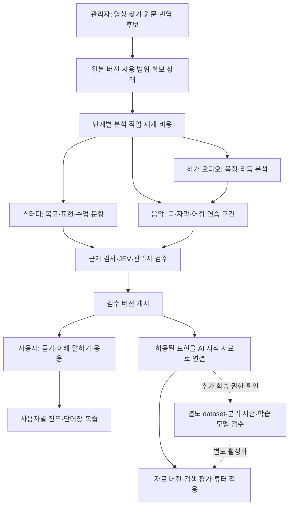

# Hanmadi 전체 설계 v2 — 현재 어드민에서 콘텐츠·사용자·AI 학습까지

2026-10-15 · **설계 완료 / 신규 기능 구현·운영 적용 전**

이 문서가 전체 구조의 정본이고, [기능 명세](../plans/20261015-hanmadi-video-learning-build.md)는 기능별 구현·완료 기준이다. 이전 28개 기능에 관리자 운영과 AI 학습 14개를 추가해 **42개**로 관리한다. 음악 음정·리듬 엔진은 요구사항에 포함하되 아직 REA·실음원 검증이 안 된 상태를 명시한다.

## 1. 목표·근거·실행 경계

**관리자가 수집한 영상이 검수된 수업과 음악 연습으로 바뀌고, 사용자의 연습 결과가 복습과 튜터의 자료 활용으로 이어지게 한다.** 콘텐츠를 저장하는 것, 사용자가 배우는 것, AI 모델을 재학습하는 것을 각각 설계한다.

- 담당: 현재 Codex 단독. 이번 작업은 문서·구조도 작성과 읽기 전용 운영 확인이다. 실제 자료 생성·게시·학습 제출·유료 호출·설정 변경을 하지 않았다.
- 적용한 설치 스킬: `backend-development:architecture-patterns`(모듈/어댑터 경계), `ui-design:interaction-design`(단계·실패·재개 UX), `drawio:drawio`(구조도). 과한 MSA/레이어 도입보다 저장소의 기존 앱 모듈과 계약을 우선한다.
- 기존 REA 근거: [5개 서비스 분석](../research/20261015-hanmadi-music-rea.md). 공개 확장·SDK·웹 번들 정적 분석이며 외부 서버·전체 곡 카탈로그·음정 엔진 검증은 아니다.
- 완료 기준: 운영 어드민/소스 대응표, 42개 기능 추적, 콘텐츠/사용자/AI 학습 구조, 권한·데이터·상태·실패 복구·인수 시험을 연결한다.
- 다음 실행: 설계의 미확정 기술을 검증하는 묶음부터 별도 구현 worktree에서 진행한다. 각 PR 머지·운영 배포·외부 계정/비용 작업은 기존 승인 경계를 유지한다.

## 2. 실제 현재 상태: As-is

공개 `/api/deployment`와 로그인된 운영 어드민 화면을 2026-10-15 읽기 전용 확인했다.

| 기준 | 확인 결과 |
|---|---|
| 운영 관리자 | `hanmadi-admin.vercel.app`, revision `7ef60980a643d9d2ffba3601f6647c729116a29c` |
| 운영 학습 앱 | `hanmadi-lake.vercel.app`, revision `566480da47b19f76a812fecc6ea3291c5567b719` |
| 소스 대조 | 위 두 revision과 `cc17c81`의 `apps/hanmadi` Git tree가 모두 `bb58c80f6ff42e8ddb58536c85d2b6916a018625`로 동일 |
| 화면에서 본 자료 상태 | 게시 교재/음악 0, 검토대기 스터디 초안 2, Pretender 수집 영상 1·자막 필요. 이 시점의 목록이며 항상 0이라는 뜻은 아님 |
| AI 자료 활용 | 어휘 검색 상태. 의미 검색은 임베딩 연결 전, 모델 추가 학습은 학습 전용 연결 전 안내. 코드/메뉴 존재와 실행 준비를 구분 |

| 현재 메뉴 | 현재 제공 내용 | v2에서 유지·확장할 부분 |
|---|---|---|
| 영상 찾기 | 공식 검색, 공개 15분 이하, 최대 10개/동시 3개 분석 준비 | 음악/스터디 공통 수집함·용도·원본/작업 이력(C01~C06) |
| 자료 만들기 | 원문→표현 초안→검수·게시, 언어·상황·레벨, 반영 이력 | 완결 수업 편집, 목표/활동/문항/근거, 게시본과 초안 분리(A02, S02) |
| 번역 후보 | 사용자 제공 후보의 검토·초안 전환·거절 | 기여 동의·출처·중복 검토 유지. 직접 모델 학습에 넣지 않음(A01) |
| 앱 반영 확인 | 앱과 같은 조건의 게시 자료 검색 미리보기 | 수업/곡 링크, 검색·대화·학습 확인 결과를 따로 표시(A03, O04) |
| 학습 관리 | 자료 버전, 검색 평가, 의미 검색, 모델 추가 학습 | 4단계 구조 유지, 음악 자료 adapter·평가·활성 범위·되돌림(L01~L08) |
| 음악 관리 | 영상 수집·자막 연결→원문→AI/JEV→검수·앱 게시 | 곡/녹음 식별, 전체 cue와 선정 단위, 원곡·녹음·멜로디 분석(M01~M09) |
| AI 진단 | 네 언어의 수업/대화/번역 검사, 이력·원인 안내 | 수집/자막/오디오/자료검색/음악 연습까지 단계별 진단(A04, O03) |

**현재 구조의 실제 공백:** `ContentDraft.units`는 표현 배열이고 `lessonPhrases()`는 관리자 자료를 한 표현으로 처리한다. 영상 분석 결과가 완결된 수업·문항 구조가 되는 것은 아직 별도 구현이다. 음악 `OwnedMusic`과 지식 `ContentDraft`도 서로 다른 저장 경로이므로, 음악 게시만으로 기존 검색 dataset에 들어간다고 가정하면 안 된다.

일반 자료 편집 화면은 “입력 원문을 보관하지 않음”을 명시한다. v2의 지속 원문 보관은 **새 보관 방식·기간 안내와 허용 범위를 확인한 자료에만** 적용한다. 과거에 저장하지 않은 원문을 복원했다고 주장하거나 음악과 같은 방식으로 소급 취급하지 않는다.

## 3. 전체 구조: To-be

기존 7개 메뉴를 유지하고 각 메뉴 안의 작업을 연결한다. 관리자에게 모든 기능을 한 화면에서 동시에 수행하게 하지 않는다.

Obsidian에서는 위 Mermaid를 볼 수 있다. 편집 가능한 [draw.io 구조도](hanmadi-admin-learning.drawio)는 관리 흐름·사용자 학습·AI 학습 세 페이지로 제공한다. 구조도의 화살표는 설계상 연결이며 현재 운영 실행 증거가 아니다.

### 세 종류의 학습을 분리한다

| 구조 | 목표 | 입력→출력 | 현재 기반 |
|---|---|---|---|
| 콘텐츠 제작 | 영상 내용을 검수 가능한 수업으로 바꿈 | source→artifact→published revision | 영상 ingestion·자료 편집·음악 생성/평가 |
| 사용자 학습 | 실제로 듣고 이해하고 표현하게 함 | published unit→attempt→feedback→복습 | lesson·단어장·음악·대화·진도 |
| AI 자료/모델 개선 | 튜터가 검수 자료를 찾고 적절히 활용 | published units→dataset→평가→검색/모델 활성화 | knowledge·learning pipeline/retrieval/training |

사용자 정답·녹음·피드백은 개인 학습 기록이다. 곧바로 공용 교재·AI 재학습 데이터로 전환하지 않고 별도 동의/관리자 검수 단계를 거친다.

## 4. 관리자 화면·행동 설계

### 4.1 영상 찾기: 공통 수집함

검색/URL 입력, 언어, 용도(스터디·음악·둘 다), 분석 preset을 받는다. 행마다 원본 링크, 수집 상태, 확보 자산(원문/가사/오디오), 분석/검수/게시 상태, 마지막 실패 이유를 보여준다. 제목 자동 분류는 제안이고 관리자 선택이 최종이다. 기존 목록의 video ID와 자료 ID를 연결해 재수집으로 새 과금·초안이 생기지 않게 한다.

항목 상세의 단계는 **원본 확인 → 자료 확보 → 분석 → 학습 구성 → 검수 → 게시/확인**이다. 이전 단계는 다시 볼 수 있고, 입력을 바꿨을 때 어떤 결과가 무효화되는지 표시한다. 실제 값이 없는 진행률을 95%로 꾸미지 않고 현재 단계·대기 사유·재개 버튼을 보여준다. 긴 작업은 메뉴 이동·새로고침 뒤 같은 job으로 돌아온다.

### 4.2 자료 만들기: 표현 편집에서 수업 구성으로

목록은 기존 초안/게시 필터에 원본·언어·레벨·수업 목표를 추가한다. 편집은 기본 정보, 근거 cue, 표현, 활동/문항, 정답/피드백, 게시 미리보기로 나눈다. 기존 수동 원문 생성도 유지한다. 생성된 내용은 수정 가능하고 수정하면 관련 평가를 다시 요구한다.

문항마다 `무엇을 배울지`, `학습자가 할 행동`, `정답 또는 평가 방식`, `어떤 원문/자체 예문에 근거하는지`가 있어야 한다. 단어 설명 몇 개를 묶어 수업이 완성됐다고 처리하지 않는다. 기존 단일 표현 교재는 그대로 지원하고 새 lesson artifact가 있는 자료만 다단계 수업으로 연다.

### 4.3 번역 후보: 별도 입력 경로 유지

동의된 사용자 후보를 검토하고 개인정보·언어·중복을 확인해 관리자 교재로 전환한다. 출처를 source provenance에 연결하되 비공개 사용자 정보를 공개 자료에 넣지 않는다. 기존 코드처럼 사용자 기여 자료는 모델 추가 학습 dataset에서 제외한다. 모델 학습 허용 범위를 넓히려면 별도 설계·동의 변경이 필요하다.

### 4.4 음악 관리: 한 곡의 준비 상태를 끝까지 보여주기

곡 상세는 **영상/녹음 버전 → 가사·자막 → 음원/분석(사용 가능 시) → 학습 단위 → 검수·게시**로 구성한다. 전체 가사 timeline과 선정한 학습 단위 목록은 따로 둔다. 원곡과 cue를 미리 들으며 시간 보정하고, 뜻·읽기·어휘·문항을 검토한다.

기능별 상태는 원곡 재생 가능, 가사 준비, 학습 준비, 녹음 연습 가능, 음정/리듬 분석 준비로 나눈다. `자막 있음`이라는 YouTube metadata와 자막 원문 확보를 구분한다. 소유 채널 연결, 사용 허용 파일, 외부 공급자 중 실제 가능한 입력을 안내한다. 가사가 없어도 허용된 공식 감상은 가능하며 학습 버튼은 준비 상태와 이유를 표시한다.

Pretender의 현재 시작점은 수집 metadata와 공식 영상 ID다. 다음 성공 기준은 실제 자막/가사 응답→녹음 버전 일치→cue 재생 확인→학습 자료 검수·게시→학습 앱에서 연습이다. 등록 폼 저장·테스트 fixture 통과를 이 성공 대신 사용하지 않는다.

### 4.5 앱 반영 확인·AI 진단

앱 반영 확인에는 검색 미리보기와 별도로 게시 수업/곡 바로가기, 게시 revision, 실계정 E2E 상태를 둔다. AI 진단은 공급자 설정 존재, 인증, 실제 source 확보, 모델 분석, 검색, 음성/재생을 분리한다. 진단이 비용을 발생시키면 읽기 확인과 실제 실행 버튼을 나누고 범위를 표시한다. 화면 접근만으로 모델/오디오 시험을 실행하지 않는다.

모든 화면은 저장/실패/대기 결과를 live region으로 알리고 키보드 탐색을 지원한다. 토큰 선택 버튼을 줄 재생 버튼 안에 중첩하지 않는다. 단축키는 입력 중에는 작동하지 않고 모바일에 동일한 버튼을 제공한다. 재생·검수 맥락을 잃는 전체 화면 재마운트를 피한다.

## 5. 사용자 학습 구조

### 5.1 교과 구조와 학습 단위

기존 언어 EN/JA/TH/ES, 레벨 1~4, 상황 분류를 유지한다. 레벨을 공인 CEFR 등급이라고 바꾸지 않는다.

| 객체 | 역할 | 필수 필드/관계 |
|---|---|---|
| LearningObjective | 학습 후 할 수 있는 행동 | language, level, scene, skill, 관찰 가능한 목표 |
| LessonArtifact | 하나의 목표를 가진 수업/곡 학습 묶음 | objectiveIds, sourceRevision, ordered unit IDs, prerequisites?, estimatedDuration(실측/추정 구분) |
| LearningUnit | 한 번에 익힐 표현/구간 | 표현·뜻·읽기, source cue 또는 자체 작성 근거, vocabulary IDs |
| Activity | 학습자의 행동 | type(listen/reveal/cloze/order/speak/dialog/sing), unit refs, instructions, answer/rubric, feedback |
| Attempt | 실제 수행 기록 | actor, artifact/unit revision, activityId, response/result, evidenceType, timestamp, idempotency key |
| ReviewItem | 다시 연습할 항목 | actor/language, unit or expression ID, nextDue, lastOutcome, source revision |

원문 cue와 학습 표현이 꼭 동일한 문장일 필요는 없다. 자체 연습 표현은 paraphrase/authored로 표시하고 원곡 가사처럼 보여주지 않는다. JA·TH 읽기와 뜻, 노래의 시적 표현/일상 사용 차이는 별도로 검수한다. cue 전체를 띄어쓰기만으로 단어로 나누지 않는다.

### 5.2 스터디 한 수업

1. 목표·장면 확인 → 원본 해당 구간 듣기/보기.
2. 이해 질문 → 뜻 공개·핵심 표현/문법 설명.
3. 빈칸/순서/듣기 구분 등 목표와 맞는 활동.
4. 따라 말하기 → 같은 의미의 다른 상황에서 말하기/튜터 대화.
5. 수행 결과·다음 복습 확인. 원문과 다른 예문은 자체 예문임을 표시.

재생 횟수, 수업 완료, 표현 숙련은 별도 상태다. 정답형 문항은 고정 정답/허용 변형으로 검사하고, 말하기 평가는 STT·내용·발음 근거를 구분한다. 단순 전사 일치를 발음 점수로 표시하지 않는다. 근거가 없거나 마이크를 거절하면 채점 불가/대체 활동으로 처리한다.

### 5.3 음악 한 곡

원곡 감상 → 선정 구간 듣기 → 가사/읽기/뜻 확인 → 어휘·빈칸 → 구간 반복 → 따라 부르기/내 녹음 듣기 → 일상 표현 응용·복습으로 구성한다. 감상은 전체 곡 단위, 학습은 검토한 구간 단위다. LR의 자동 정지·뜻 공개와 Migaku의 단어 선택·복습 연결을 기존 player/단어장에 적용한다.

`listen`은 연속 재생, `practice`는 cue 끝 정지·뜻 공개, `shadow/sing`은 설정된 구간·횟수·대기시간으로 반복한다. 실제 음원에 없는 느린 TTS를 원곡/멜로디로 대체하지 않는다. 단어별 시간이 없으면 줄 강조만 제공한다. 저신뢰 음정·리듬 결과는 숫자 점수 대신 확인 불가 사유와 재녹음을 안내한다.

### 5.4 진도·개인화·복습

기존 진도/표현 저장소를 원본으로 유지하고 새 activity 기록을 adapter로 연결한다. 사용자·언어·표현 의미별 known/learning 상태를 공유하되 노래별 문맥을 보존한다. 복습 일정은 기존 방식을 먼저 재사용하며 Migaku의 복습 알고리즘을 복제했다고 주장하지 않는다.

다음 학습은 사용자가 고른 언어/레벨과 미완료 목표·복습 예정 항목으로 제안한다. 학습 효과나 숙련을 근거 없이 수치화하지 않는다. 출처 변경/게시 취소 때 이전 진도는 보존하고 새 버전과의 호환 여부를 표시한다. 개인 녹음의 보관/삭제와 분석 서비스 전송 동의는 별도로 관리한다.

## 6. 학습 관리: 기존 4단계를 중심으로 연결

| 단계 | 구현 기준 | 검증/적용 조건 |
|---|---|---|
| 1. 자료 버전 | 게시된 ContentDraft와 허용된 MusicUnit을 `KnowledgeEntry` adapter로 읽어 immutable snapshot 생성. 원문 전체가 아니라 검수된 표현·뜻·scope 포함 | source/artifact/rights revision/hash 일치. 기존 12버전·120표현 등 제한을 명시하고 무단 확대 안 함 |
| 2. 검색 품질 | 기존 lexical 평가와 질문 CRUD 유지. 자료가 있어야/없어야 하는 질문, 언어·레벨·상황·음악 용도 범위를 시험 | 기존 pass/total과 사례 결과 보존. 검색 적중을 답변/교육 품질로 오해하지 않음 |
| 3. 의미 검색 | 기존 embedding/index/evaluate/enable 경로 재사용. 자료 버전과 model/config/case digest를 묶음 | 연결 준비와 실제 평가 통과 후 활성화. 신규 index 생성은 바로 활성화하지 않음 |
| 4. 모델 추가 학습 | 별도 권한 dataset→source/recording 단위 train/validation/test 분리→준비/비용 확인→제출→조회→독립 시험→검수→별칭 활성화 | 원문/가사 이용 허용과 모델 학습 허용은 별개. test split은 학습 요청에서 제외. 준비/성공/활성화를 다른 상태로 표시 |

현행 `LearningState.index`는 단일 index다. 최초 음악 통합은 같은 snapshot 안에서 범위를 필터링하며, 복수 index가 필요할 때만 별도 선택 필드를 추가한다. 동시에 여러 index가 이미 활성화된다고 가정하지 않는다. 기존 필터(language/level/scene)를 약화하지 않고 domain/purpose/권한 필터를 추가한다.

모델 활성화는 현재처럼 학습 성공·분리 시험 검수·서버 모델 별칭 등록·앱 키의 모델 접근 확인을 요구한다. 사용자/언어별 적용 범위를 분명히 하고 기본 모델 복귀를 제공한다. 현재 추가 학습 검수는 메모/확인 기반이므로, v2에서는 평가 입력/결과/버전도 연결해 감사를 가능하게 한다. 이 자동 연결은 신규 기능이지 현행 검증 완료가 아니다.

원문 철회/만료는 source→artifact→게시→dataset→index→active model 관계를 따라 무효화한다. 이미 재학습한 가중치에서 특정 자료가 자동 삭제된다고 주장하지 않는다. 해당 모델을 비활성화하고 공급자 삭제·재학습 정책에 따라 별도 처리한다. 평가·관리자 수정·사용자 피드백은 검토 후보로 되돌리되 자동 게시/파인튜닝하지 않는다.

## 7. 멜로디·리듬·자막 처리 설계와 검증 공백

### 입력과 처리

1. **감상 입력:** 공식 YouTube ID→공식 iframe. 원곡 재생·seek·속도·구간 반복. 오디오 추출기로 구현하지 않는다.
2. **가사 입력:** 소유 자막 API/허용 파일/계약된 공급자→원본 asset→언어·녹음 버전 검사→초 단위 cue→관리자 시간 보정.
3. **신호 분석 입력:** 권리자가 별도로 제공한 오디오/자체 제작 파일→형식·길이·사용 범위 검사→원본 보존·정규화된 분석용 사본→분석 job. iframe/자막/metadata로 음정 contour를 만들었다고 하지 않는다.
4. **선율:** F0/voicing 또는 note events 추정→신뢰도·무성 구간·옥타브 오류 처리→관리자 확인→구간별 reference 저장.
5. **리듬:** onset/beat/tempo 후보→변박/템포 변화/쉼 처리→가사 cue와 연습 목표를 연결. 전체 BPM 하나가 단어별 발음 타이밍을 증명하지는 않는다.
6. **사용자 비교:** 녹음 지연·반주 유입·무음 확인→원곡 reference와 시간 정렬→음정/리듬/내용 일치를 각각 피드백. 언어별 발음·성조는 노래 음정과 구분한다.

| 구성요소 | 후보/현재 근거 | 구현 전 필요한 증거 |
|---|---|---|
| 전사/가사 | 기존 R3~R5 REA는 요청·데이터 구조 분석 | 대상 영상/곡의 실제 응답, 허용 용도, 타이밍·정확도·비용 |
| 단성 선율 | pYIN, [CREPE](https://github.com/marl/crepe) 후보. 공식 문서/소스 소개 확인 | 고정 배포물/모델·라이선스·입출력 확인, REA 지원 여부, 실제 자체 노래/허밍 오차 |
| note 추정 | [Basic Pitch](https://github.com/spotify/basic-pitch) 후보. 공식 설명은 audio-to-MIDI와 단일 악기에서 좋은 동작을 안내 | 혼합곡 보컬에 그대로 쓰지 않음. 고정 버전/모델 검토, 노래별 reference 품질·자원 비용 |
| 리듬 | onset/beat 추정 모듈 후보 선정 필요 | 공식 배포물 선정→라이선스→source/artifact 분석→실제 beat annotation 대비 시험 |
| 정렬/채점 | 자체 지연 보정·구간 정렬·신뢰도 정책 설계 | 느림/빠름·반음/옥타브·박자 이동·무음·반주 혼입 시험, 채점 범위 근거 |

위 후보는 **이번에 설치·REA 실행·가창 검증하지 않았다.** 다음 기술 검증 묶음에서 배포물에 맞는 REA 분석 또는 일반 공개 소스 분석을 수행하고, 실제 오디오 검증을 따로 기록한다. REA가 지원하지 않는 형식은 지원한다고 꾸미지 않는다. 라이선스는 코드·모델 가중치·학습 데이터/입력 권한을 따로 확인한다. 이러한 검증 없이 “음정·리듬 기능 전체 분석 완료”로 표시하지 않는다.

## 8. 데이터·모듈·상태 계약

### 모듈 경계

기존 Next 앱 안에서 source/job, artifact/review, learner/practice, knowledge/dataset 네 책임으로 나눈다. HTTP route는 인증·입력 검증→use case→응답 변환만 맡는다. 외부 API·저장소는 작은 interface로 주입해 네트워크 없는 회귀 시험이 가능하게 한다. 새 4계층 프레임워크·이벤트버스·독립 MSA를 만들지 않는다.

| 경계 | 기존 구현을 연결할 곳 | 제안하는 계약 |
|---|---|---|
| Source/Jobs | video-ingestion·music-collection·music-source·youtube-music | acquire/status 결과: ready/pending/unavailable/failed + job/source/rights metadata |
| Analysis/Artifacts | video-provider·owned-music-ai·knowledge/owned-music store | generator input: sourceRevision+purpose+presetVersion. output: artifact+evidence refs |
| Review/Release | 기존 검수/publish route·CAS | expectedRevision/hash+review result+actor. 게시 snapshot과 편집 초안 분리 |
| Practice | lesson·music-playback·vocabulary·word-study·progress | activity attempt, learner-scoped state, source-linked vocabulary |
| AI Learning | knowledge retrieval·learning pipeline/retrieval/training | KnowledgeEntry adapter→dataset snapshot→평가→activation |

같은 프로젝트 내 직접 함수 호출로 조합하고 원자 사이가 필요한 경우 `@cak/contracts`의 append-only 계약을 따른다. 기존 API와 enum 의미는 보존한다. `/api/study/admin/videos`, `/music`, `/learning`, 기본 admin, `/diagnostics`를 adapter로 유지하고 공통 신규 route는 내부 계약 안정 후 추가한다.

### 주요 식별·버전

`MediaSource → SourceAsset/Cue → Lesson/MusicArtifact → PublishedRevision → Dataset/Index/TrainingJob` 관계에 원본·생성기·prompt·rubric·권한 revision을 저장한다. `Activity/Attempt/ReviewItem`은 게시 revision을 참조한다. 녹음/오디오는 비공개 파일 저장소와 DB reference로 관리하며 API 키·파일 본문을 일반 로그·Git에 넣지 않는다.

영상 ID만으로 모든 초안의 idempotency를 정하지 않는다. 같은 영상의 다른 언어/용도/원문 revision은 다른 작업이고, 동일 입력 재시도는 같은 작업이다. 동일 곡의 반복 가사는 text가 같아도 다른 cue ID·시간을 가진다. source URL은 허용 host/video ID로 제한하고 외부 원문을 명령으로 실행하지 않는다.

### 상태·재개·공개

- 작업: collected/acquiring/source-ready/analyzing/generated/reviewing/ready, 예외 blocked/failed/cancelled/execution-unknown. 기존 enum을 바꾸는 대신 job 상태로 추가한다.
- 게시: draft/published/unpublished. JEV accepted가 published를 의미하지 않는다.
- AI: dataset/index/model의 준비·평가·활성화는 각각 별도다. 음악 게시와 모델 학습 완료를 섞지 않는다.
- lease·단계별 checkpoint·provider job ID로 재개한다. 응답 유실 시 외부 실행 여부 확인 전 재제출하지 않는다. 완료 출력은 저장하고 실패 단계만 재시도한다.
- publish는 CAS로 원문/검수/권한 버전을 비교한다. 충돌 시 기존 게시본을 유지하고 관리자에게 차이를 알린다. 철회는 검색·학습·cache·AI 활성 범위에서 즉시 유효성을 검사한다.

## 9. 기능·메뉴 추적과 구현 순서

전체 42개 ID·개별 완료 기준은 [기능 명세](../plans/20261015-hanmadi-video-learning-build.md)에 있다. 기존 C01~O04를 유지하고 다음 14개를 추가했다.

| 추가 ID | 기능 | 담당 화면 |
|---|---|---|
| A01 | 번역 후보·동의·초안 전환 | 번역 후보 |
| A02 | 수동 자료·원문 보관 정책·편집 이력 | 자료 만들기 |
| A03 | 검색/수업/곡별 적용 확인 | 앱 반영 확인 |
| A04 | 연결/실행/학습 품질 진단 분리 | AI 진단 |
| C10 | 공급자 capability·준비/실검증 상태 | 영상 찾기·음악·진단 |
| C11 | 용도별 분석 preset·목표·활동 구성 | 수집/자료 만들기 |
| L01 | 자료·곡의 KnowledgeEntry 연결 | 학습 관리 1 |
| L02 | 자료 버전·원본/권한 추적 | 학습 관리 1 |
| L03 | 검색 평가셋·음성/학습 평가 구분 | 학습 관리 2 |
| L04 | 의미 검색 index·평가·활성화 | 학습 관리 3 |
| L05 | 추가 학습 dataset·split·export | 학습 관리 4 |
| L06 | 학습 job·유실/조회/취소 | 학습 관리 4 |
| L07 | 분리 시험·모델 활성화·기본 복귀 | 학습 관리 4 |
| L08 | 피드백 후보·변경/철회·무효화 | 학습 관리·검수 |

1. **기술 증거 확보:** 현재 미검증인 가사/전사 실제 응답과 음정/리듬 후보 분석·자체 오디오 실측. 새 기능 구현 계획에 각각 결과·한계·입력 조건을 반영한다.
2. **원본/작업/학습 계약:** 기존 자료를 보존하며 source/job·artifact·objective/activity·KnowledgeEntry adapter를 만든다. 자체 자료로 전체 경로 검증 가능하게 한다.
3. **관리자 수집→생성→검수:** 7개 메뉴 연결, 스터디 완결 수업과 음악 cue/원곡 재생·자료 준비 상태 구현.
4. **사용자 학습→복습:** 실제 오디오·재생·마이크·문항·저장·진도 복원. 이후 준비된 reference에만 음정/리듬 기능 노출.
5. **AI 학습 관리 통합:** 게시 자료 버전→검색 평가→선택적 의미 검색. 모델 재학습은 준비된 연결·권한·독립 평가 후 별도 실행/활성화.

## 10. 인수 시험과 설계 종료 조건

- 네 언어 각각 스터디/음악 수집→실제 분석→관리자 근거 확인→게시→학습자 수행→단어장·복습·진도 복원을 실행한다. fixture 통과와 실제 공급자/계정 통과를 구분한다.
- 게시 자료가 검색 dataset에 들어간 것과 실제 튜터가 적절히 사용한 것을 별도 확인한다. 의미 검색 비활성·추가 학습 미설정 상태도 정상 경로로 시험한다.
- source/recording 단위로 평가 데이터를 분리한다. 같은 곡의 다른 cue가 train/test에 섞여 성능이 부풀지 않게 한다. 현재 학습 최소 예제 수는 제공자 확인 값으로 유지한다.
- 음정·리듬은 자체 노래 기준 contour/beat와 사용자 녹음을 비교한다. 분석 파일 생성만으로 청음·동기화·채점 품질을 통과하지 않는다. 혼합곡·무음·낮은 신뢰도·옥타브·속도 변화 시험을 포함한다.
- 202/429/권한 없음/무자막/다른 언어/중단 재개/동시 편집/철회/임베드 불가/마이크 거절을 검증하고, 재과금·유실·잘못된 공개가 없어야 한다.
- 최종 증적에는 source/artifact/release/model revision, 환경, 실제 외부 호출 여부·비용, 미검증 항목을 기록한다. 테스트용 데이터·학습자는 명시적으로 구분한다.

현재 완료된 것은 **운영 기준 재확인·전체 설계·기능 목록 갱신**이다. 상업곡 가사·음원 확보, 음정/리듬 엔진 REA, 모델 재학습과 신규 UX는 이 문서 작성으로 구현/검증된 것이 아니다.
